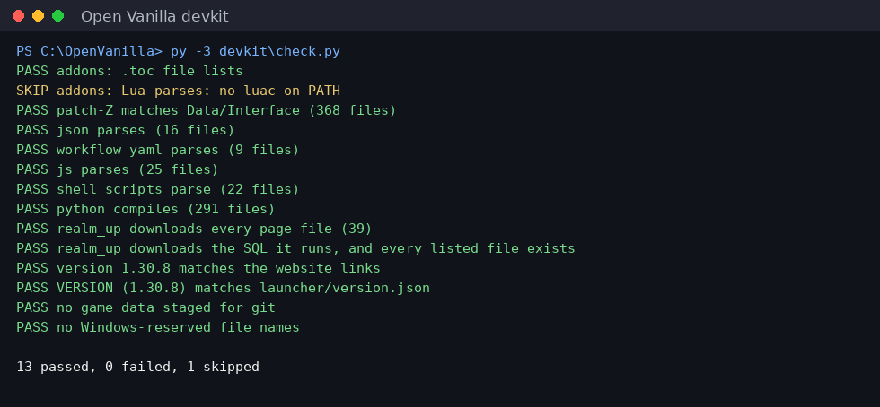

# Open Vanilla Devkit

**Test a change in seconds on your PC, try it against the live realm without pushing, and let a staging realm prove it before players get it.** Start with `devkit\Dev.bat`.



```
your PC                                   the server
-----------------------------------       -------------------------------------------------
check.py, Lua sim, SQL tests (seconds)    push -> staging hot update -> Herald Lite -> live
dev proxy: live realm + your files        nightly: full Herald in a real browser
```

| Part | What it is | Run |
|---|---|---|
| `check.py` | Repo checks: addon .toc lists, Lua parses, JSON/YAML/JS/shell/Python parse, version vs website links, no game data in git | `py -3 devkit\check.py` |
| `sim/` | Every Classic+ addon in a fake 1.12 game: 111 tests in about 2 seconds | `lua5.1 devkit/sim/run_tests.lua` |
| `db/` | Our SQL applied twice to a throwaway MariaDB with stock rows | `py -3 devkit\db\test_sql.py` |
| `proxy/` | **Zero-push loop:** the live realm at `localhost:8080`, with the addons and page files from your folder | `Dev.bat` option 4 |
| `heraldlite/` | A headless test bot (Rust): logs in, buys from a vendor, checks weapon skills, trades | `Dev.bat` option 5 |
| `staging/` | The staging realm and `promote.sh` (staging, then Herald Lite, then live) | |
| `tests/` | The project's tests (launcher, Herald, Autopilot, server; some need a display: `xvfb-run`) | `python -m pytest tests` |

**Rules:** no Blizzard game data in git (the sim and SQL tests use none), and nothing in `devkit/` ships to players. More: [devkit/README.md](devkit/README.md).

## Part of Open Vanilla

[Open Vanilla](https://github.com/orionopenwow/OpenVanilla) is a free, open-source, community-built Vanilla project ([openvanilla.app](https://openvanilla.app/), [Discord](https://discord.gg/r6nj5p8U4)). Its products:

- [Vanilla Forge](https://github.com/orionopenwow/vanilla-forge): The Open Vanilla creator app: maps, models, creatures, quests, items and addons, tested in a copy of your game and published as a signed pack.
- [Vanilla Agents](https://github.com/orionopenwow/vanilla-agents): Your AI coding helpers as heroes in a cosy inn: you roam, they work, a checker verifies every quest.
- [Herald](https://github.com/orionopenwow/herald): The Open Vanilla Discord bot, the in-game World chat bridge, and Herald Autopilot: he plays a character for you, simulates gear and learns from play.
- [Open Vanilla Server](https://github.com/orionopenwow/openvanilla-server): Everything that runs a realm: the realm images and CMaNGOS patches, the web/asset service, Server Studio, Play Solo packs, the relay, and the turnkey Hetzner deployment.
- [Open Vanilla Launcher](https://github.com/orionopenwow/openvanilla-launcher): OpenVanilla.exe: play online, solo or in the browser, the Workshop, signed updates and live news; plus the release packaging.
- [Vanilla Remastered UI](https://github.com/orionopenwow/vanilla-remastered-ui): The in-game addon suite (WenillaCore, Quests, Transmog, Achievements, Guilds and the rest), Classic+ data, and the Workshop addon catalog.
- [openvanilla.app](https://github.com/orionopenwow/openvanilla-site): The Open Vanilla website (GitHub Pages) and the player manual.
- [Open Vanilla Devkit](https://github.com/orionopenwow/openvanilla-devkit) (this one): Test a change in seconds on your PC, try it against the live realm, and let a staging realm prove it first; plus the project's checks and tests.
- [Open Vanilla Agent Kit](https://github.com/orionopenwow/openvanilla-agent-kit): Let an AI coding agent change your copy of Open Vanilla for you: addons, interface, your own realm's rates and NPCs.
- [Open Vanilla Art & Tools](https://github.com/orionopenwow/openvanilla-art-tools): Art sources, UI kits and the generator scripts behind the launcher, site and addon artwork; plus the project's maintenance tools.

## License

MIT: see [LICENSE](LICENSE).

## About this repository

This repository is published from **Open Vanilla** (commit `8fa8928e54`: Release 1.36.0). Changes are made there and arrive here with each release, so please open issues and pull requests on [Open Vanilla](https://github.com/orionopenwow/OpenVanilla/issues).

World of Warcraft is a trademark of Blizzard Entertainment, Inc. Open Vanilla is an independent fan project, not affiliated with or endorsed by Blizzard Entertainment. No Blizzard game files are included: you need your own.
